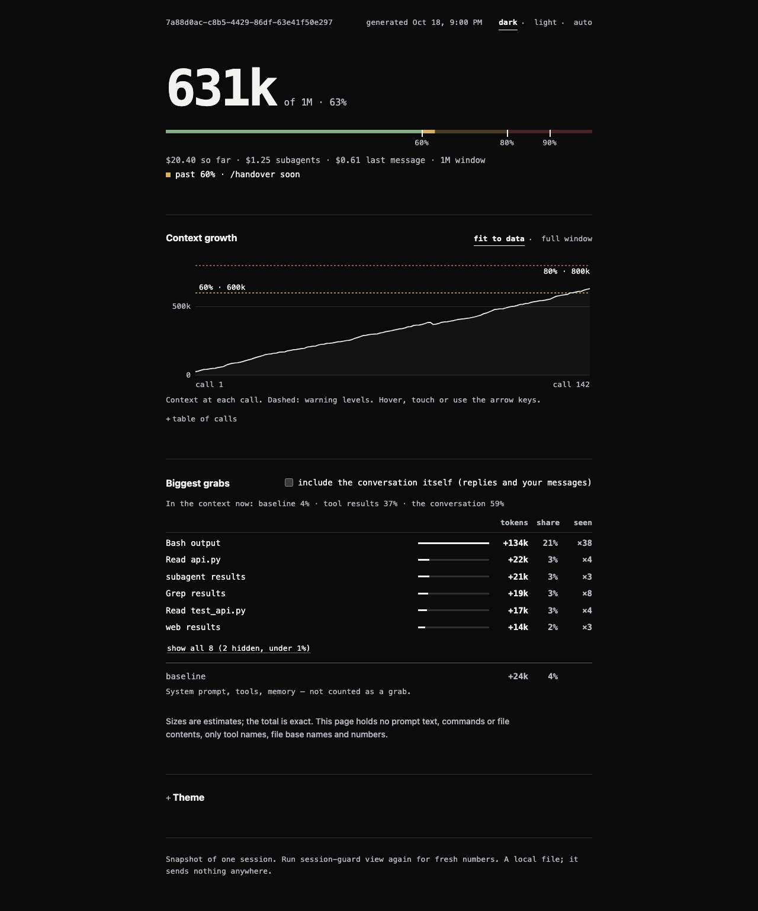
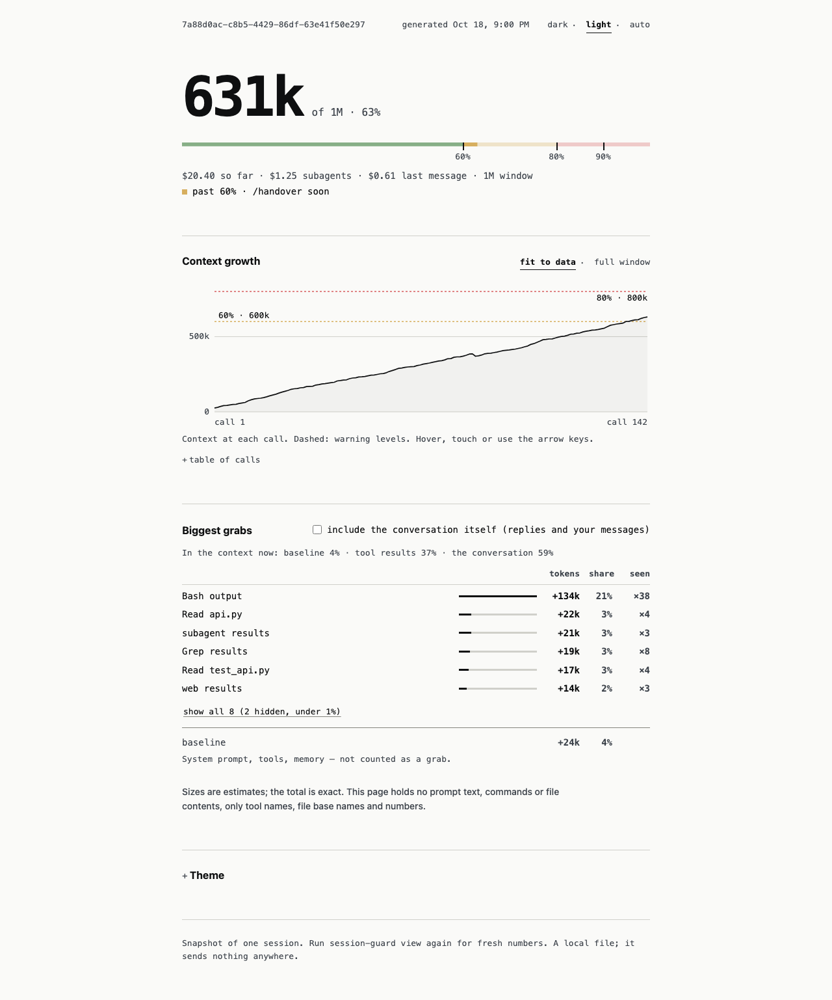
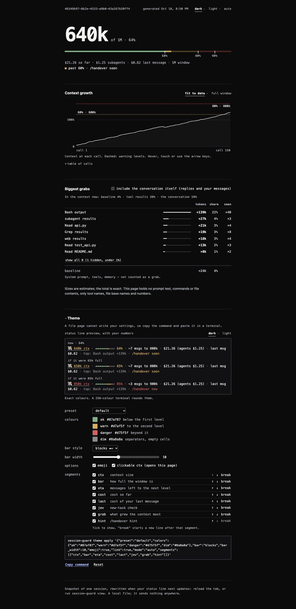
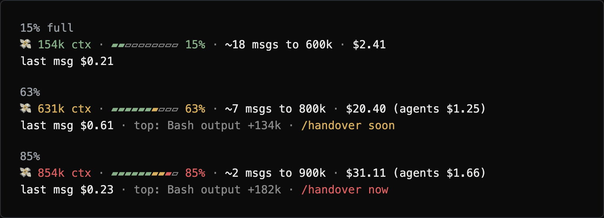
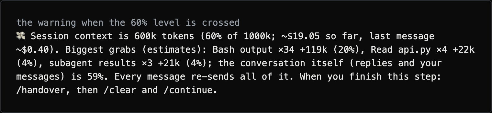
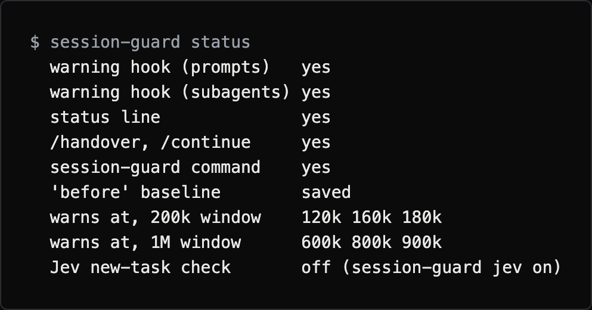
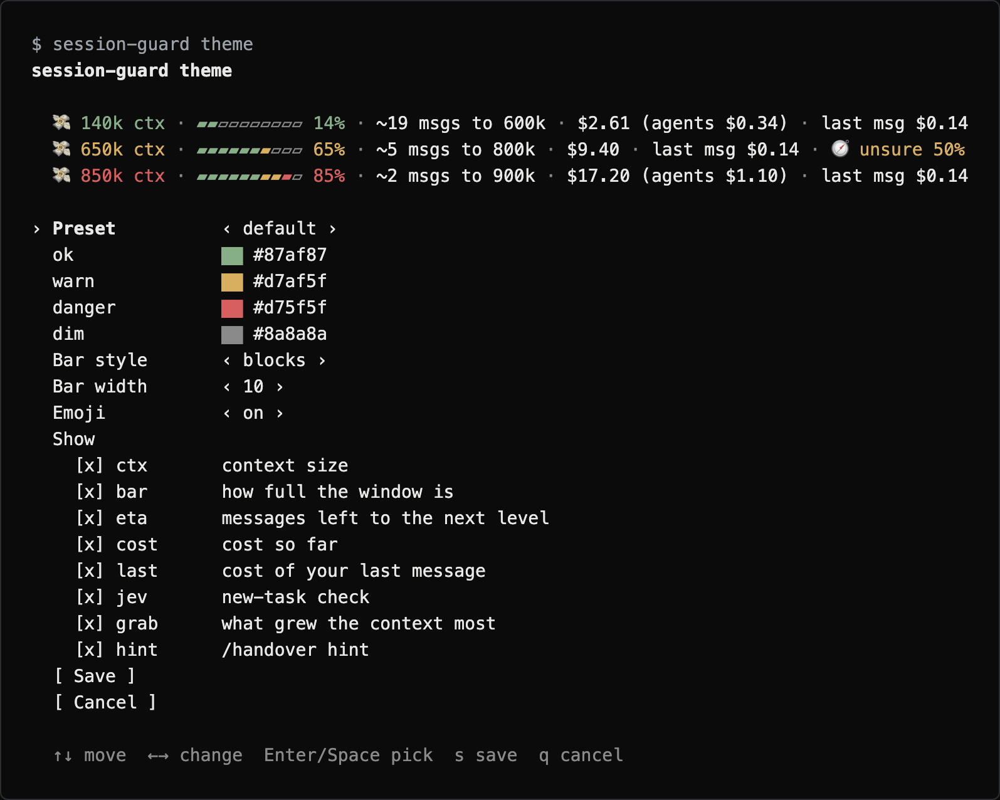

# session-guard

A Claude Code hook and status line that warns you when a session gets expensive, so you can hand over to a fresh one in time.

[](https://github.com/Swanand58/session-guard/actions/workflows/test.yml)
[](LICENSE)
[](#supported-platforms)

```bash
curl -fsSL https://raw.githubusercontent.com/Swanand58/session-guard/main/install.sh | bash
session-guard status     # check it worked, then restart Claude Code
```







The page screenshots use an invented demo session.

## In the terminal

The status line at about 15%, 63% and 85% of a 1M window. The bar and the
numbers change colour as the session fills up, and from the first level on it
shows the biggest grab and a `/handover` hint. Here it is laid out on two lines
so the image stays readable (`session-guard theme set 'segments=ctx,bar,eta,cost|last,grab,hint'`);
by default it is one line.



*Terminal images are rendered from the tool's real output on a demo session.*

The warning you get once, when the context passes the first level (60% of the window), with what grew it:



## What it does

Every message re-sends the whole session, so a long session costs more per
message. session-guard:

- **warns you** when a session's context passes 60%, 80% and 90% of the
  model's context window, with the dollar cost so far and the cost of your
  last message
- **names what grew the context** (the biggest grabs: files read, command
  output, web results, subagent results)
- **counts subagents**: their cost is in every number, and a subagent that
  grows past the same levels shows you a warning
- gives you **/handover** (save a short note) and **/continue** (resume from it
  in a fresh session), and both work from a **folder that holds several git
  repos**
- shows a **status line** with a bar, the cost and a hint, with **themes** and a
  **picker** for the colours and layout
- writes a **session page** you can open in a browser: context chart, biggest
  grabs, cost and a theme studio
- can compare your costs **before and after** installing it (a
  [report](#benchmark-before-vs-after) from your own numbers)
- **(optional, Jev, off by default)** spots when you start a *new task* in a big
  session and holds that prompt back once, so you can hand over instead

## How it works, and what it is not

A hook runs on each prompt you send (and after tool calls, to watch subagents).
It reads the session's transcript on your computer, adds up the tokens and
prints a warning when a level is passed.

- **It warns. It does not stop, shorten or compact your session.** You decide
  when to run `/handover`. The one exception is the optional Jev check, which can
  hold back a single prompt; send it again and it goes through.
- **Sizes are estimates.** The context size is exact. The split into "what grew
  it" is an estimate based on text length.
- **Costs are estimates.** They use the rates in the `PRICES` table in
  `guard.py` (GitHub Copilot's published rates, with the date they were checked
  in the comment above it). Rates change and your plan may bill differently, so
  treat the numbers as a guide, not an invoice. A model it does not know is
  priced like an expensive one. Edit `PRICES` to match your own rates.
- **It fails open.** If anything goes wrong, your prompt goes through.
- It needs token counts in the transcript. See [Troubleshooting](#troubleshooting).

## Privacy

- **It reads** your local Claude Code transcripts (`~/.claude/projects`) and,
  for the report, Copilot CLI session logs if you have them.
- **It stores**, under `~/.claude/session-guard/`: a small state file per session
  (which levels it has warned at, the window size, the last new-task score), a
  log of numbers only (`events.jsonl`), the report files, and the session pages
  (written when you run `session-guard view`, not by the status line).
  The pages hold only numbers, tool names and file base names (`report.py`, not
  the path), never your prompts, commands, file contents or URLs. `/handover`
  also writes a note into your project's `.handover/` folder; that note is
  whatever Claude Code wrote in it, so keep it out of commits.
- **It sends nothing.** There is no telemetry. The one exception is the optional
  Jev check, **off by default**: when you turn it on, it sends your last 5
  prompts and the new one, each cut short, to `api.typesafe.ai`. Check your
  company's policy before you enable it. The installer and `session-guard update`
  also download session-guard from GitHub.

## Supported platforms

macOS and Linux are tested in CI (Python 3.9 and the newest Python 3). Windows
is a manual install only and is not tested; see
[Manual install](#install) and [Troubleshooting](#troubleshooting).

## Install

```bash
curl -fsSL https://raw.githubusercontent.com/Swanand58/session-guard/main/install.sh | bash
```

That downloads the latest release of session-guard to `~/.session-guard` (or
the newest code on `main` if there is no release yet) and adds it to
`~/.claude/settings.json` (a backup is saved next to it first). It adds the
warning hook, a live cost meter in the status line, the `/handover` and
`/continue` commands, and the `session-guard` command (a link in
`~/.local/bin`). It also saves your last 30 days of costs as the "before"
numbers for the [benchmark](#benchmark-before-vs-after). Restart Claude Code
afterwards. Check it worked with `session-guard status`:



*Rendered from the tool's real output in a temporary home folder.*

To install a particular version, set `SESSION_GUARD_REF` to a tag or a branch:

```bash
curl -fsSL https://raw.githubusercontent.com/Swanand58/session-guard/main/install.sh | SESSION_GUARD_REF=v0.1.0 bash
```

If your shell says `session-guard: command not found`, add `~/.local/bin` to
your PATH (the installer prints the line to add).

```
💸 150k ctx · ▰▰▰▰▰▰▰▰▱▱ 75% · ~4 msgs to 160k · $5.39 · last msg $0.44 · 🧭 same task · /handover soon
```

The bar shows how full the context window is. `~4 msgs to 160k` is a guess: how many
more messages until the next warning level, at your recent pace. See
[Customize the status line](#customize-the-status-line) for colours and layout.

- Already have a status line? It keeps showing, above ours.
- Run the same command again, or `session-guard update`, to update. It never
  adds anything twice. If your `/handover` or `/continue` file differs from the
  new one, it is replaced and your old one is saved next to it as `*.bak`.
- From a clone instead: `python3 install.py`.

### Uninstall

```bash
session-guard uninstall            # undo everything it added; keeps your reports and logs
session-guard uninstall --purge    # also delete its files, reports and logs
```

Your old status line comes back. A settings backup is saved first. Lost the
command? This does the same from scratch:

```bash
curl -fsSL https://raw.githubusercontent.com/Swanand58/session-guard/main/install.sh | bash -s -- uninstall --purge
```

Keep handover notes out of commits, per repo, without touching `.gitignore`:

```bash
echo ".handover/" >> .git/info/exclude
```

<details><summary>Manual install (e.g. Windows)</summary>

1. Copy `commands/*.md` to `~/.claude/commands/`.
2. Merge into `~/.claude/settings.json`:

   ```json
   {
     "hooks": {
       "UserPromptSubmit": [
         { "hooks": [{ "type": "command", "command": "python3 /FULL/PATH/TO/session-guard/guard.py", "timeout": 10 }] }
       ],
       "PostToolUse": [
         { "hooks": [{ "type": "command", "command": "python3 /FULL/PATH/TO/session-guard/guard.py", "timeout": 10 }] }
       ]
     },
     "statusLine": { "type": "command", "command": "python3 /FULL/PATH/TO/session-guard/statusline.py" }
   }
   ```

   To keep an existing status line, put its command after ours:
   `python3 .../statusline.py bash /path/to/yours.sh`

</details>

## Commands

| Command | What it does |
|---|---|
| `session-guard install` | Set up the hooks, status line, `/handover`, `/continue` and the command. Safe to run twice. |
| `session-guard uninstall [--purge]` | Remove them. `--purge` also deletes its files, reports and logs. |
| `session-guard update` | Get the latest version. |
| `session-guard status` | The version, what is installed, when it warns, and whether Jev is on. |
| `session-guard version` | Print the version (also `--version`). |
| `session-guard report before\|after\|compare [--days N]` | Your costs before vs after. See [Benchmark](#benchmark-before-vs-after). |
| `session-guard recall id` | The id of the current session. |
| `session-guard recall <id> "words"` | Search an earlier session (up to 5 short matches). |
| `session-guard repos` | Every git repo under this folder, with branch and changes. |
| `session-guard jev on` / `off` | Turn the new-task check on (it asks for your key) or off. |
| `session-guard theme` | Open the picker: choose the status line colours and layout with the arrow keys. See [Customize the status line](#customize-the-status-line). |
| `session-guard theme show\|list\|use\|set\|reset\|apply` | Print or change the theme with commands, for scripts. |
| `session-guard view [--session ID] [--no-open]` | Open the page for this session (or another): context chart, biggest grabs, cost and a theme studio. See [The session page](#the-session-page). |
| `session-guard test` | Run the self-checks. |

Inside Claude Code: `/handover` saves a short note, `/continue` resumes from it.

## Customize the status line

Run this in a terminal and pick the look with the arrow keys. The preview at
the top (14%, 65% and 85% of a 1M window) changes as you move.

```bash
session-guard theme
```



*Rendered from the tool's real output on a demo session. Pressing Enter on a colour opens a palette, which also takes a typed hex colour.*

| Key | What it does |
|---|---|
| `↑` `↓` (or `k` `j`) | Move between rows |
| `←` `→` (or `h` `l`) | Change a value: preset, bar style, bar width, emoji |
| `Enter` or `Space` | On a colour: open the palette. On a segment: show or hide it. On Save or Cancel: do it. |
| `s` | Save |
| `q` or `Esc` | Cancel. Nothing is saved. |

In the palette, move with the arrow keys and press `Enter` to pick. `Esc` goes
back to the old colour. `#` lets you type your own hex colour. The last visible
segment cannot be hidden. The picker keeps the order of the segments. To change
the order, use `theme set segments=...` (below). Under "Show" the picker
lists every segment (`ctx`, `bar`, `eta`, `cost`, `last`, `cache`, `jev`, `grab`, `hint`).

Without a terminal (in a script, or piped), `session-guard theme` prints the
current theme and a hint instead. To print it any time:

```bash
session-guard theme show
session-guard theme list          # every preset, previewed
```

**Presets** are ready-made colour sets: `default`, `ocean`, `mono`,
`high-contrast` and `colorblind` (blue, orange and magenta, no red/green pair).

```bash
session-guard theme use ocean
session-guard theme set warn=#ff9900          # one colour (the # is optional)
session-guard theme set bar=solid bar_width=14
session-guard theme set emoji=off
session-guard theme reset                     # back to the defaults
```

There are four colours: `ok`, `warn`, `danger` and `dim` (the separators and
empty bar cells). Other settings:

| Setting | Values |
|---|---|
| `bar` | `blocks` (▰▱), `solid` (█░) or `dots` (●○) |
| `bar_width` | 4 to 20 cells, default 10 |
| `emoji` | `on` or `off` |
| `mode` | `auto`, `truecolor` or `256`. `auto` uses 24-bit colour when `COLORTERM` is `truecolor` or `24bit`, else the nearest of 256 colours. |
| `segments` | which parts to show, in which order (below) |

`theme use` replaces your own colours with the preset. A bad value prints what
is valid, exits with an error and changes nothing.

**NO_COLOR:** if the `NO_COLOR` environment variable is set to anything, the
status line has no colours at all.

**Segments** are the parts of the line, shown in the order you give:

| Name | Shows |
|---|---|
| `ctx` | context size, e.g. `💸 141k ctx` |
| `bar` | how full the window is, e.g. `▰▰▱▱▱▱▱▱▱▱ 14%`. Each cell is coloured by the zone it sits in: before the first warning level, between level 1 and 2, beyond. |
| `eta` | `~12 msgs to 160k`: tokens left to the next level, divided by how much context grew per message lately. Hidden until there are 2 messages, or if context is not growing. |
| `cost` | cost so far, with the subagents' part if it is $0.005 or more |
| `last` | cost of your last message |
| `cache` | `cache 94% (last miss: ttl_expiry)`: prompt-cache hit rate and the cause of the last miss. Only with [cachekit](#prompt-cache-hit-rate-optional-cachekit). |
| `jev` | the new-task check (only when Jev is on) |
| `grab` | `top: Read report.py +38k`: the biggest thing in the context. Only after the first warning level. See [What grew the context](#what-grew-the-context). |
| `hint` | `/handover soon` or `/handover now` |

A segment with nothing to show is skipped. To split the status line over two
lines, put `|` between the lines:

```bash
session-guard theme set 'segments=ctx,bar,eta|cost,last,jev,hint'
```

The theme is saved in `~/.claude/session-guard/theme.json`. The picker writes
the preset and only what differs from it. You can also set
all of it at once with JSON (this is the format any tool that builds a theme
should use):

```bash
session-guard theme apply '{"preset": "ocean", "bar": "dots", "segments": [["ctx", "bar"], ["cost", "last"]]}'
```

Every key is optional. If the file is missing or broken, the defaults are used. Segment names it does not know (for example `spark`, which was removed) are skipped.

## The session page

```bash
session-guard view                 # this folder's newest session, opened in your browser
session-guard view --session ID    # another session (`session-guard recall id` prints the current one)
session-guard view --no-open       # only write the file and print its path
```

It is one HTML file, `~/.claude/session-guard/view/<session id>.html`. The
design is minimal: one column, flat, no cards, mono type, heavy enough to read
at a glance. It opens **dark**. A small `dark · light · auto` switch at the top
right changes that, and the page remembers your choice (`auto` follows your
system). All text meets WCAG AAA contrast (7:1 or better). It shows:

- **Context now**, how full the window is, the warning levels (60%, 80%, 90%
  by default) and the cost: so far, subagents, last message.
- **Context growth:** a chart of the context at each call (the latest 200),
  with a line at each warning level and a mark where you ran `/compact`.
  Hover, touch or use the arrow keys to see what grew it at that call.
  The same numbers are in a table below the chart.
- **Biggest grabs:** the things that grew the context, biggest first, and the
  baseline (system prompt, tools, memory) shown apart. Rows under 1% of the
  context are hidden behind "show all". A tick box adds the conversation
  itself (replies and your messages). Sizes are estimates; the total is exact.
- **Theme studio**, folded away until you open "Theme" (or add `#theme` to the
  address): colour pickers, presets, bar style and width, emoji, and which
  segments to show, in which order, on how many
  lines. A live preview of the status line uses your real numbers at the
  current fill and at 65% and 85%. **Copy command** gives you a
  `session-guard theme apply '...'` line. A plain file page cannot write your
  settings, so you paste that line in a terminal.

**Private and offline.** The page is a local file, written only when you run
`session-guard view`. It loads nothing from the internet and sends nothing. It holds numbers, tool names and file base names
(`report.py`, not the path). It never holds your prompts, commands, file
contents or URLs. The file is readable only by you, and `session-guard
uninstall --purge` deletes it with the rest of the session-guard folder. The page
is a snapshot: run `session-guard view` again for fresh numbers.

## What grew the context

A warning also says what made the context grow, so you can change what you do:

```
💸 Session context is 630k tokens (63% of 1000k; ~$9.40 so far, last message ~$0.14). Biggest grabs (estimates): subagent results ×3 +41k (7%), Read report.py +38k (6%), Bash output ×4 +22k (4%); the conversation itself (replies and your messages) is 61%. Every message re-sends all of it. When you finish this step: /handover, then /clear and /continue.
```

- **It is an estimate.** The context size is exact. Every split is not: the
  growth between two calls is shared by the text length of what arrived
  (the model's reply without its thinking, tool results, your messages). Read
  "+38k" as "about 38k".
- **What you can change comes first.** The list shows tool results (files read,
  command output, web results, subagent results). the model's replies and your
  messages are not listed one by one; they appear as a closing "the
  conversation itself is N%" when together they are 10% or more.
- **Private.** It uses only tool names, file base names (`report.py`, not the
  path) and sizes. Never file contents, commands, prompts or URLs. It is shown
  on screen only and is not stored: `events.jsonl` still holds numbers only.
- Items under 3% of the context are left out. Nothing to show? The warning is
  the same as before. A drop in context (`/compact`) starts the count again.
- Subagent warnings list their top two, from the subagent's own transcript.
- The `grab` status line segment shows the single biggest tool-related item. It reads the
  transcript once more per update, which added about 0.03 to 0.07 seconds on a
  7 to 21 MB transcript.

## Configure

Warnings exist because every message re-sends the whole session. The fuller
the session, the more each message costs. The *context window* is how much
the model can hold at once.

By default you get a warning at 60%, 80% and 90% of the window. On a 200k
window that is 120k, 160k and 180k tokens. On a 1M window it is 600k, 800k
and 900k. The window size comes from Claude Code's status line. If that is
missing, session-guard assumes 200k, and switches to 1M once a call goes over
200k.
Keep the status line the installer adds: without it, 1M-window users get early warnings until a call passes 200k (or set `SESSION_GUARD_WINDOW`).

Want fewer or later warnings? Set the levels as shares of the window (three
numbers between 0 and 1, comma-separated):

```
SESSION_GUARD_LEVELS=0.8,0.9,0.95
```

If the window size is detected wrongly, set it in tokens:

```
SESSION_GUARD_WINDOW=1000000
```

Put these lines in `~/.session-guard/.env` (in a clone: `.env` next to
`guard.py`) or export them as environment variables. A bad value is ignored
and the defaults are used.

## Jev new-task check (optional, off by default)

```bash
session-guard jev on     # asks for your TypeSafe API key (typing is hidden), then turns it on
session-guard jev off    # turns it off; keeps the key
```

The key is saved in `~/.session-guard/.env` (in a clone: `.env` next to
`guard.py`, which is git-ignored), readable only by you. You can also set
`TYPESAFE_API_KEY` and `SESSION_GUARD_JEV=1` as environment variables instead.

On macOS with Python from python.org, HTTPS calls fail with
`CERTIFICATE_VERIFY_FAILED` until you run
`/Applications/Python 3.12/Install Certificates.command` once. The Jev check
then silently does nothing, so run that, or point the hook at Homebrew's `python3`.

Only runs when context is above 40% of the window, or 150k tokens, whichever is
lower (80k on a 200k window). It sends your last 5 prompts and
the new prompt (truncated) to TypeSafe's API. **Check your
company's policy before enabling this on work code.** If Jev is slow (>4s) or
down, the prompt goes through normally.

## Daily use

1. Work normally. A 💸 warning appears when the session gets big.
2. At a good stopping point: `/handover`, then `/clear`, then `/continue`.
3. The note records the old session's id. If the new session needs a detail the
   note left out, it searches the old transcript (up to 5 short matches):
   `session-guard recall <session-id> "a few words"`

### Folders with several repos

You can start Claude Code in a plain folder that holds your repos (not a repo
itself). `/handover` finds every git repo under that folder, at any depth, and
writes down which repo is where, with its branch. The note stays in the folder
you started in. `/continue` checks each repo's branch against the note. It
skips `node_modules`-style folders, hidden folders, and anything inside a repo,
and stops at 40 repos.

## Subagents

A subagent starts with a fresh context and has its own transcript, so:

- **Cost:** the warnings and the status line add subagent cost to the session
  total. The status line shows their part: `$4.61 (agents $0.67)`. The context
  number stays the main session's own, because that is what gets re-sent.
- **Size:** if a subagent's own context passes the same levels (60%, 80% and
  90% of the window), you get one warning per level with its context size and
  cost. The subagent is not told to stop; it carries on. This uses a
  `PostToolUse` hook, which also runs (and exits straight away) on the main
  session's tool calls.
- **Report:** `session-guard report` shows subagent runs and their share of the cost.

Already installed? Run the install command again to add the subagent hook.

## Prompt-cache hit rate (optional, cachekit)

[cachekit](https://github.com/Swanand58/cache-kit) is a local proxy that sees
every API call and explains why the prompt cache missed. If it is installed and
the session goes through it, the `cache` segment shows this session's hit rate
and the cause of its most recent miss:

```
💸 28k ctx · ▰▰▱▱▱▱▱▱▱▱ 14% · $0.43 · last msg $0.22 · cache 56% (last miss: ttl_expiry)
```

```bash
npm install -g https://codeload.github.com/Swanand58/cache-kit/tar.gz/refs/heads/main   # until it is on npm
cachekit proxy                                    # leave it running
ANTHROPIC_BASE_URL=http://localhost:8787 claude   # in another terminal
```

- Without cachekit, or for a session that did not go through the proxy, the
  segment stays hidden. An older cachekit (npm 0.1.0) shows nothing either.
- A cold start (`first_call`) is not shown as a miss.
- session-guard never sets `ANTHROPIC_BASE_URL` for you. If the proxy stops,
  Claude Code cannot reach the API until you start it again, or open Claude
  Code without that variable.
- cachekit's dollar figures use API prices, so they are not shown next to
  session-guard's.
- Saved your own segment list? Add `cache` to it, for example
  `session-guard theme set 'segments=ctx,bar,eta,cost,last,cache,hint'`.

## Test

```bash
session-guard test
```

## Benchmark: before vs after

**A caution first.** This needs weeks of steady, heavy use and many sessions to
mean anything. One huge session can distort the averages, and a quiet month
compared with a busy one tells you nothing. Treat the numbers as a rough guide.

It reads both **Claude Code** (`~/.claude/projects`) and **GitHub Copilot CLI**
(`~/.copilot/session-state`) sessions. For Copilot CLI it uses the AI credits
GitHub actually billed, when the session log has them. Copilot CLI only logs
totals per session, so the context-size rows (marked `*`) cover Claude Code only.

**1. Install session-guard.** It saves your last 30 days as the "before"
numbers for you. (Redo it any time with `session-guard report before`.)

**2. Work normally for ~30 days.**

**3. Then:**

```bash
session-guard report after
```

It covers every day since step 1, so the two periods never overlap, and
prints them side by side:

```
                                           BEFORE        AFTER   CHANGE
Tokens per session (median)                   ...          ...      ...
Cost per session (avg, $)                     ...          ...      ...
Cost per message ($)                          ...          ...      ...
...
```

`session-guard report compare` shows it again later. Results
are saved in `~/.claude/session-guard/before.json` and `after.json`.

Compare the **per-session and per-message** numbers: totals depend on how
much work you did. For tokens per session, look at the **median**: one huge
session can make the average very large.

The report reads only token counts, model names, timestamps and
slash-command names, never your messages. Jev blocks and overrides come from
`~/.claude/session-guard/events.jsonl` (numbers only). An override is
roughly a time Jev was wrong.

## Troubleshooting

- **Python 3.9 or newer.** No packages to install.
- **Windows:** use `python` (or `py`) instead of `python3` in the settings,
  with a full `C:\...` path. Use Windows Terminal for colours and emoji. The
  one-line installer needs bash (use WSL), or install by hand as above and run
  commands as `python cli.py status`, `python cli.py report after`, and so on.
- **Nothing shows at all?** Run `/hooks` in Claude Code. If your company
  manages Claude Code settings, it may block personal hooks or status lines.
- **Status line is empty?** Your Claude Code setup may not record token
  counts in its transcripts (some Copilot API proxies don't). Check one
  transcript line for `"usage"`.
- **Jev never shows (🧭)?** A company firewall may block `api.typesafe.ai`.
  session-guard then carries on without it.
- Only Claude Code shows warnings and the status line. For Copilot CLI,
  `session-guard report` reads its sessions, but it has no live warnings.

## Contributing

Bug reports and small pull requests are welcome. See [CONTRIBUTING.md](CONTRIBUTING.md).

## Security

session-guard runs local hooks and a status line. To report a vulnerability, see [SECURITY.md](SECURITY.md).

## Changelog

See [CHANGELOG.md](CHANGELOG.md).

## License

MIT. See [LICENSE](LICENSE).
